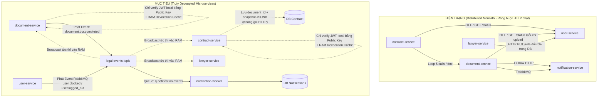

# 📋 ĐẶC TẢ KỸ THUẬT & KẾ HOẠCH TỰ ĐỘNG KHẮC PHỤC VI PHẠM MICROSERVICES
> **Dành cho AI Agent / Kỹ sư tự động tối ưu hóa hệ thống Backend (Legal Assistant AI)**  
> **Mục tiêu:** Tự động tái cấu trúc (Refactor), khử bỏ phụ thuộc chéo (Decoupling), tối ưu hóa CSDL và chuẩn hóa Event-Driven qua RabbitMQ mà không làm gãy luồng người dùng.

---

## 🧭 PHẦN 1: BỐI CẢNH KỸ THUẬT & NGUYÊN TẮC HỆ THỐNG HIỆN TẠI

* **Ngôn ngữ & Framework:** Python 3.14 (AsyncIO / FastAPI), SQLAlchemy, Psycopg, Uvicorn.
* **Hạ tầng Container:** Docker Desktop / Docker Compose (13 containers: Gateway Nginx, RabbitMQ, 10 Microservices).
* **Cơ sở dữ liệu:** 100% **Database-per-Service** (Mỗi service kết nối 1 database PostgreSQL độc lập trên Supabase).
* **Cơ chế Xác thực (Auth):**
  - Chữ ký số bất đối xứng RSA (Private Key tại `user-service`, Public Key được mount vào tất cả services tại `/run/keys/jwt_public.pem`).
  - Thư viện dùng chung: `libs/common_auth` chịu trách nhiệm giải mã và xác minh JWT.
  - Thu hồi token in-memory: Module `common_auth.revocation` đã có sẵn background consumer lắng nghe RabbitMQ exchange `legal.events.topic` (bắt event `user.logged_out`, `user.blocked`) để lưu JTI và `blocked_at` vào RAM.

---

## 🎯 PHẦN 2: MỤC TIÊU KIẾN TRÚC (CURRENT STATE vs TARGET STATE)



---

## 🛠️ PHẦN 3: KẾ HOẠCH HÀNH ĐỘNG CHI TIẾT (ACTIONABLE BLUEPRINTS)

AI Agent thực thi theo đúng 4 giai đoạn độc lập dưới đây để đảm bảo an toàn tuyệt đối:

---

### GIAI ĐOẠN 1: TRIỆT TIÊU GỌI NGƯỢC USER-SERVICE (SỬA LỖI 4, 5, 6)

#### 1.1. Bản chất vi phạm
* `document-service/app/core/security.py:L35-L38` và `app/services/user_status.py:L71`: Mỗi khi upload file, dependency `document_writer` mở HTTP GET sang `http://user-service:8000/internal/v1/users/{id}/status`.
* `contract-service/app/services/user_gate.py:L43`: Mỗi khi tạo hợp đồng lại gọi HTTP GET sang `user-service/status`.
* `contract-service/app/services/admin_gate.py:L28`: Gọi HTTP sang `user-service/api/v1/users/me` để check role Admin.

#### 1.2. Giải pháp kỹ thuật tự động:
1. **Đối với `document-service`:**
   * Trong `services/document-service/app/core/security.py`:
     Sửa hàm `document_writer`: Thay vì gọi `status.ensure_document_write(...)`, hãy kiểm tra trực tiếp từ `user: CurrentUser`.
     ```python
     # BEFORE:
     async def document_writer(request: Request, user: CurrentUser = Depends(document_user), status=Depends(get_user_status)):
         await run_in_threadpool(status.ensure_document_write, user.id, request.state.request_id)
         return user

     # AFTER:
     async def document_writer(request: Request, user: CurrentUser = Depends(document_user)):
         # Token đã được common_auth giải mã bằng Public Key và đã check RAM blacklist từ RabbitMQ
         return user
     ```
2. **Đối với `contract-service`:**
   * Trong `services/contract-service/app/services/admin_gate.py`:
     Bỏ lệnh gọi HTTP sang `/api/v1/users/me`. Thay vào đó, xác thực trực tiếp role admin:
     ```python
     # Sửa AdminGate.ensure_admin:
     # Kiểm tra trực tiếp token payload: role == "admin"
     ```
   * Trong `services/contract-service/app/services/user_gate.py`:
     Bỏ lời gọi HTTP sang `/status`. Khi user chưa bị block trong `common_auth.revocation`, cho phép tạo hợp đồng bình thường.

---

### GIAI ĐOẠN 2: KHỬ BỎ N+1 HTTP CALLS BẰNG DATABASE SNAPSHOT (SỬA LỖI 1, 2, 3)

#### 2.1. Đề xuất cải tiến Database (Database Refactoring):
Để `contract-service` không cần gọi HTTP sang `document-service` để đọc file nhiều lần:
* **Thêm cột lưu trữ mềm vào bảng hợp đồng:**
  Bảng `contract_draft_documents` hoặc `contract_drafts` bổ sung cột JSONB để lưu bản sao trích xuất (Snapshot):
  ```sql
  -- Chạy migration trên CSDL của contract-service:
  ALTER TABLE public.contract_draft_documents 
  ADD COLUMN IF NOT EXISTS ocr_data_snapshot JSONB DEFAULT NULL,
  ADD COLUMN IF NOT EXISTS file_name VARCHAR(255) DEFAULT NULL;
  ```

#### 2.2. Luồng giao tiếp chuẩn:
1. **Frontend tải file lên:** Người dùng upload tài liệu lên `document-service`. Kết quả trả về gồm:
   `{ document_id: "uuid", extraction: { ... } }`.
2. **Frontend gửi sang `contract-service`:** Khi tạo hợp đồng, Frontend gửi luôn `document_id` và dữ liệu bóc tách sẵn có trong request body `POST /api/v1/contracts/drafts`.
3. **Trong `contract-service/app/services/draft_references.py`:**
   * Thay vì chạy vòng lặp tuần tự `for document in documents: self.fetch(...)`, nếu Frontend đã đính kèm dữ liệu, lưu thẳng vào `ocr_data_snapshot`.
   * Nếu vẫn cần xác minh từ xa: Xây dựng **1 Batch API duy nhất** trên `document-service` (`POST /api/v1/documents/batch-info` nhận danh sách `[id1, id2, ...]`) để chỉ gọi **1 request HTTP duy nhất** thay vì vòng lặp N lần.

---

### GIAI ĐOẠN 3: CHUẨN HÓA EVENT BROKER & VẶT CODE THỪA (SỬA LỖI 11, 12, 13)

#### 3.1. Dọn dẹp Dual Notification trong `document-service`:
* **Vấn đề:** Đang có 2 cơ chế thông báo dẫm chân lên nhau:
  - Cơ chế 1: `app/notification_worker.py` + `app/services/notification_delivery.py` (Ghi DB Outbox rồi gửi HTTP có `time.sleep` blocking).
  - Cơ chế 2: `app/worker.py:L31` gọi `publish_event_sync("document.ocr.completed", ...)` đẩy lên RabbitMQ.
* **Hành động kỹ thuật:**
  1. Giữ lại **Kiến trúc RabbitMQ** (Cơ chế 2) vì nó chuẩn Event-Driven, không gây nghẽn HTTP.
  2. Vô hiệu hóa hoặc xóa bỏ `notification_worker.py` và `notification_delivery.py` trong `document-service`.
  3. Gỡ bỏ file `docker-compose.document-notifications.yml` (nếu có) để tránh sinh tiến trình thừa thãi.

#### 3.2. Sửa lỗi Thread Safety trong `procedure-service`:
* **Vị trí:** `services/procedure-service/app/repositories/procedure_record_repository.py:L35-L38`
* **Vấn đề:** Khai báo `_session = requests.Session()` ở cấp module toàn cục trong môi trường async FastAPI.
* **Hành động kỹ thuật:**
  - Thay thế `requests.Session` toàn cục bằng connection pool quản lý an toàn (hoặc dùng `httpx.AsyncClient` hoặc query qua SQLAlchemy session cục bộ của request).

---

### GIAI ĐOẠN 4: BẢO MẬT PHÂN TÁN & CHỐNG SẬP (CIRCUIT BREAKER - SỬA LỖI 7, 8, 9, 10)

#### 4.1. Bổ sung Circuit Breaker Pattern cho các cuộc gọi HTTP liên dịch vụ:
* Khi `agent-service` gọi `rag-service` (`services/agent-service/app/services/rag_client.py`):
  - Cài đặt cơ chế đếm lỗi liên tiếp (Ví dụ: 3 lần timeout liên tiếp $\rightarrow$ chuyển trạng thái `OPEN` trong 30 giây).
  - Khi trạng thái là `OPEN`, lập tức trả về phản hồi fallback ("Hệ thống tra cứu luật đang bận, AI sẽ trả lời dựa trên kiến thức tổng quát") mà không bắt người dùng đợi 10 giây timeout.
* Áp dụng tương tự cho `contract-service` khi gọi `procedure-service`.

#### 4.2. Khắc phục "God Token" `INTERNAL_TOKEN`:
* **Vấn đề:** Cả 6 container dùng chung 1 secret `INTERNAL_TOKEN`.
* **Hành động kỹ thuật:**
  1. Ngăn chặn triệt để việc `lawyer-service` tự ý đổi role của User qua `PUT /internal/v1/users/{user_id}/role`. Luồng duyệt luật sư phải chuyển sang Event-driven:
     - `lawyer-service` phát event `lawyer.verified` lên RabbitMQ.
     - `user-service` nghe event đó và tự nó cập nhật bảng User của chính nó.
  2. Bổ sung header xác thực thống nhất khi `agent-service` gọi sang `procedure-service/api/v1/procedures/search` (`agent-service/app/main.py:L83`).

---

## 📋 PHẦN 4: TIÊU CHÍ NGHIỆM THU (ACCEPTANCE CRITERIA)

Sau khi AI hoàn tất các sửa đổi, toàn bộ hệ thống phải đạt các tiêu chí sau:

1. **Khử hoàn toàn cuộc gọi HTTP sang User Service:**
   - Trong `document-service` và `contract-service`, không còn bất kỳ request HTTP nào gửi tới cổng `user-service:8000`.
   - Thử tắt container `user-service`: Người dùng vẫn có thể upload tài liệu trên `document-service` và xem hợp đồng bình thường (miễn là JWT token còn hạn).
2. **Bộ Test Suites nội bộ phải vượt qua 100%:**
   ```powershell
   cd "D:\Legal Assistant AI\BE"
   # Test common_auth và user-service:
   py -m pytest libs/common_auth services/user-service/tests -q
   # Test contract-service và document-service:
   py -m pytest services/contract-service/tests services/document-service/tests -q
   # Test notification-service:
   cd services/notification-service; py -m pytest tests -q; cd ../..
   ```
3. **Toàn bộ 13 Docker Containers khởi động Up (healthy):**
   ```powershell
   cd "D:\Legal Assistant AI\BE"
   docker compose up -d --build
   docker compose ps
   # Kiểm tra Gateway phản hồi 200 OK:
   curl.exe -s http://127.0.0.1:8080/
   ```
4. **Không phát sinh lỗi N+1:**
   - API tạo hợp đồng (`POST /api/v1/contracts/drafts`) chỉ mất tối đa 1 cuộc gọi mạng nội bộ thay vì 5 cuộc gọi như trước.
