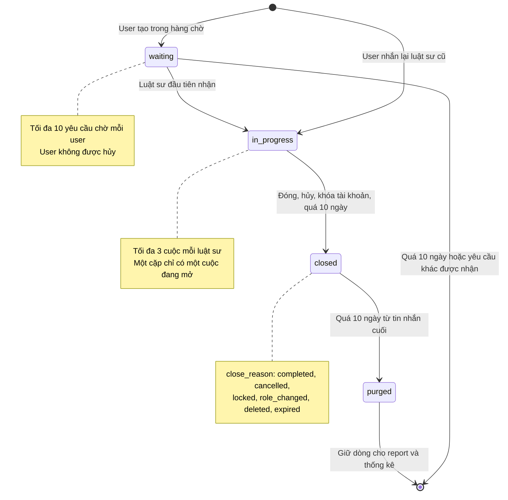
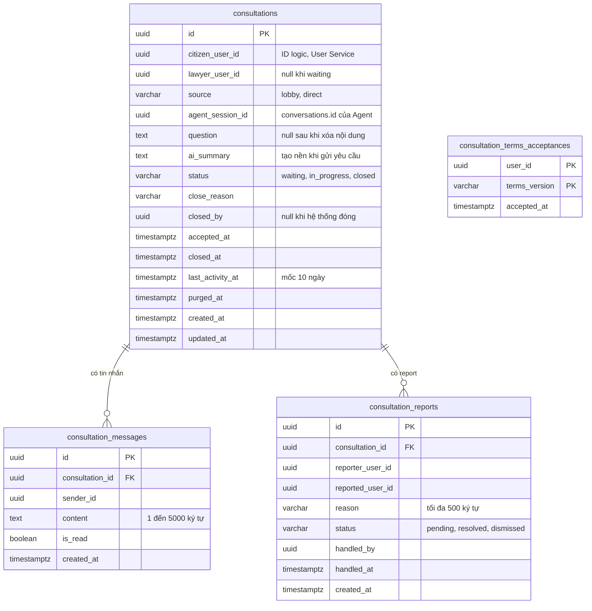

# Thiết kế Consultation Service: chat giữa user và luật sư

Bản thiết kế để nhóm chốt trước khi code. Mọi API nghiệp vụ đang `x-status: planned`, chỉ health check đã chạy.

- Contract: [`services/consultation-service/openapi.yaml`](../../services/consultation-service/openapi.yaml)
- Schema: [`services/consultation-service/database/001_consultation_schema.sql`](../../services/consultation-service/database/001_consultation_schema.sql)
- Quy ước chung: [`docs/API_GUIDELINES.md`](../API_GUIDELINES.md) mục 4, 5, 7, 8, 10

## 1. Phạm vi

Consultation Service giữ hàng chờ, chat 1-1, report và đồng ý điều khoản.

**Có trong bản demo**

- User gửi câu hỏi vào hàng chờ (`source = lobby`), luật sư đầu tiên bấm nhận thì mở box chat.
- Nhắn lại luật sư cũ (`source = direct`): mở ngay, không qua hàng chờ.
- Chat text 1-1, đánh dấu đã đọc, đóng (user hoặc luật sư), hủy (luật sư).
- Report người còn lại trong cuộc; admin xem danh sách report và xử lý.
- Đồng ý điều khoản theo phiên bản; tóm tắt AI cho luật sư.
- Thông báo bằng WebSocket và chấm đỏ (kênh `me`), chưa nối Notification Service.
- Job dọn dữ liệu quá 10 ngày.

**Quy tắc quyền**

- Phải đăng nhập. Vai trò `citizen` và `lawyer` đều tạo được yêu cầu (luật sư được dùng tính năng của người dân).
- Hàng chờ chỉ luật sư được hành nghề (`can_practice` ở Lawyer Service) xem. Mọi luật sư đều thấy mọi yêu cầu,
  không lọc theo lĩnh vực, không kiểm tra Online. Luật sư không thấy và không nhận được yêu cầu của chính mình.
- Admin không xem được nội dung chat, câu hỏi hay danh sách cuộc tư vấn; chỉ xem ai report ai và lý do.
- Luật sư không xem được lịch sử chat với AI, chỉ xem bản tóm tắt AI (xem mục 9), không cần user cho phép. Điều khoản phải nói rõ việc này.
- Tư vấn miễn phí, hệ thống không quản lý nội dung tư vấn. Tin nhắn hiển thị tên tài khoản; CCCD không bắt buộc để chat.

**Để sau demo**

Upload file trong chat, AI đánh giá report, đánh dấu toxic (cờ `warning`), Agent tự đề xuất luật sư, nối Notification Service.

## 2. Sơ đồ trạng thái

`purged` không phải giá trị của `status`: đó là cuộc `closed` đã có `purged_at` (đã xóa tin nhắn, `question`, `ai_summary`).
API coi cuộc đã purged như không tồn tại (404, không có trong danh sách), trừ `GET /consultations/previous-lawyers`.



## 3. Bảng chuyển trạng thái

| Từ | Đến | Ai làm | Điều kiện | `close_reason` |
|---|---|---|---|---|
| (mới) | `waiting` | User, `POST /consultations` với `lobby` | Đã đồng ý điều khoản, dưới 10 yêu cầu `waiting` | — |
| (mới) | `in_progress` | User, `POST /consultations` với `direct` | Đã đồng ý điều khoản; đã có cuộc `completed` với luật sư đó; luật sư còn hoạt động; hai bên chưa có cuộc mở; luật sư dưới 3 cuộc | — |
| `waiting` | `in_progress` | Luật sư đầu tiên, `POST .../accept` | `can_practice`; đã đồng ý điều khoản; không phải yêu cầu của mình; dưới 3 cuộc; hai bên chưa có cuộc mở | — |
| `waiting` | xóa dòng | Job | Quá 10 ngày từ `created_at` | — |
| `waiting` | xóa dòng | Hệ thống, trong `accept` | Một yêu cầu khác của cùng user vừa được nhận | — |
| `waiting` | xóa dòng | User Service, `close-by-user` | Người tạo bị khóa hoặc xóa tài khoản | — |
| `in_progress` | `closed` | User hoặc luật sư của cuộc, `POST .../close` | — | `completed` |
| `in_progress` | `closed` | Luật sư của cuộc, `POST .../cancel` | — | `cancelled` |
| `in_progress` | `closed` | User Service, `close-by-user` | Một trong hai bên bị khóa | `locked` |
| `in_progress` | `closed` | User Service, `close-by-user` | Luật sư bị hạ quyền (chỉ cuộc người đó là luật sư) | `role_changed` |
| `in_progress` | `closed` | User Service, `close-by-user` | Một trong hai bên bị xóa tài khoản | `deleted` |
| `in_progress` | `closed` | Job | `last_activity_at` quá 10 ngày | `expired` |
| `closed` | `closed` + `purged_at` | Job | `last_activity_at` quá 10 ngày | giữ nguyên |

`closed_by` là người bấm đóng/hủy; hệ thống tự đóng thì `null`. Cuộc bị đóng không quay lại hàng chờ.

## 4. Sơ đồ bảng



- Tên trường API khác tên cột: `citizen_id` ↔ `citizen_user_id`, `lawyer_id` ↔ `lawyer_user_id`,
  `reporter_id` ↔ `reporter_user_id`, `reported_id` ↔ `reported_user_id`.
- `last_activity_at` đặt lúc tạo, lúc nhận và mỗi tin nhắn mới. Đóng cuộc không đổi mốc này.
- Report chỉ gắn với cuộc đã có luật sư, mà dòng đó không bao giờ bị xóa, nên khóa ngoại report không cần cascade.
- Bật RLS, không policy, thu hồi quyền `anon` / `authenticated`: chỉ backend đọc/ghi qua `CONSULTATION_DATABASE_URL`.

## 5. Chống tranh chấp khi nhận yêu cầu

Hai luật sư có thể bấm nhận cùng lúc, một luật sư có thể bấm nhận nhiều yêu cầu cùng lúc, và user có thể có nhiều yêu cầu
đang chờ. Mỗi thao tác làm tăng số đếm chạy trong một transaction và lấy khóa theo thứ tự cố định:

```sql
select pg_advisory_xact_lock(1, hashtext(:citizen_user_id::text));  -- 1 = khóa phía người tạo
select pg_advisory_xact_lock(2, hashtext(:lawyer_user_id::text));   -- 2 = khóa phía luật sư
```

- Luôn khóa citizen trước, luật sư sau. Hai không gian khóa `1` và `2` tách riêng nên luật sư vừa là người tạo yêu cầu
  cũng không gây deadlock (giao dịch A khóa `1:X → 2:Y`, giao dịch B khóa `1:Y → 2:X` không đụng nhau).
- Khóa tự nhả khi commit hoặc rollback. `hashtext` trùng chỉ làm hai người chờ nhau một chút, không sai dữ liệu.

| Thao tác | Khóa | Kiểm tra trong khóa |
|---|---|---|
| Tạo `lobby` | citizen | Dưới 10 yêu cầu `waiting` chưa hết hạn |
| Tạo `direct` | citizen → luật sư | Có cuộc `completed`, chưa có cuộc mở giữa hai bên, luật sư dưới 3 cuộc |
| Nhận yêu cầu | citizen → luật sư | Như dưới |

Các bước nhận yêu cầu (`POST /consultations/{consultation_id}/accept`):

1. Lấy `pg_advisory_xact_lock` theo citizen, rồi theo luật sư.
2. Kiểm tra luật sư có dưới 3 cuộc `in_progress` và hai bên chưa có cuộc `in_progress`.
3. `UPDATE consultations SET status = 'in_progress', lawyer_user_id = ?, accepted_at = now(), last_activity_at = now()
   WHERE id = ? AND status = 'waiting'`. Không có dòng nào đổi thì trả 409 `CONSULTATION_ALREADY_ACCEPTED`.
4. `DELETE FROM consultations WHERE citizen_user_id = ? AND status = 'waiting' RETURNING id`.
5. Commit, rồi đẩy `consultation.accepted` và `consultation.removed` (danh sách id vừa xóa).

Lớp chặn cuối ở database: unique index `consultations_open_pair_key` (một cặp chỉ một cuộc `in_progress`) và
check constraint (không tự nhận, đúng cột theo trạng thái). Lỗi unique thì trả 409 `CONSULTATION_ALREADY_OPEN`.

Đóng, hủy, `close-by-user` và job chỉ làm giảm số đếm nên không cần advisory lock; chúng dùng
`UPDATE ... WHERE status = 'in_progress'`. Gửi tin dùng `SELECT ... FOR SHARE` dòng cuộc tư vấn trong cùng transaction
để không ghi tin vào cuộc vừa bị đóng. Sự kiện WebSocket luôn gửi sau commit.

## 6. Hằng số

| Tên | Giá trị | Dùng ở |
|---|---|---|
| Số yêu cầu `waiting` tối đa mỗi user | 10 | `POST /consultations` (`lobby`), 409 `WAITING_LIMIT_REACHED` |
| Số cuộc `in_progress` tối đa mỗi luật sư | 3 | `accept`, `POST /consultations` (`direct`), 409 `LAWYER_CAPACITY_REACHED` |
| Thời gian giữ dữ liệu | 10 ngày | Hết hạn `waiting` (từ `created_at`), đóng `expired` và xóa nội dung (từ `last_activity_at`) |
| `CONSULTATION_TERMS_VERSION` | biến môi trường, ví dụ `2026-11-01` | `GET /consultations/terms`, kiểm tra trước khi tạo và nhận |

Ba hằng số đầu là hằng trong code, không đưa ra biến môi trường. Job chạy mỗi giờ, nên mọi truy vấn hàng chờ, đếm yêu cầu
và nhận yêu cầu tự lọc thêm `created_at > now() - interval '10 days'` để yêu cầu quá hạn không lộ ra trong lúc chờ job.

## 7. Job dọn dữ liệu

Chạy khi service khởi động và mỗi giờ, là task nền trong process của service (không cần cron ngoài). Mỗi bước là câu
`UPDATE`/`DELETE` có điều kiện, chạy lại hay hai bản chạy cùng lúc cũng không làm sai dữ liệu.

```sql
-- 1. Xóa yêu cầu chờ quá 10 ngày → đẩy consultation.removed
delete from consultations
where status = 'waiting' and created_at < now() - interval '10 days'
returning id;

-- 2. Đóng cuộc đang mở quá 10 ngày không có tin nhắn → đẩy consultation.closed
update consultations
set status = 'closed', close_reason = 'expired', closed_at = now(), updated_at = now()
where status = 'in_progress' and last_activity_at < now() - interval '10 days'
returning id;

-- 3. Xóa nội dung cuộc đã đóng quá 10 ngày (cùng một transaction)
delete from consultation_messages m
using consultations c
where m.consultation_id = c.id
  and c.status = 'closed' and c.purged_at is null and c.last_activity_at < now() - interval '10 days';

update consultations
set question = null, ai_summary = null, purged_at = now(), updated_at = now()
where status = 'closed' and purged_at is null and last_activity_at < now() - interval '10 days';
```

Cuộc bị đóng `expired` ở bước 2 có `last_activity_at` đã quá 10 ngày nên bị xóa nội dung luôn ở bước 3. Dòng
`consultations` được giữ lại cho report, thống kê và `GET /consultations/previous-lawyers`.

## 8. Mã lỗi mới

| HTTP | `error.code` | API | Khi nào |
|---|---|---|---|
| 403 | `TERMS_NOT_ACCEPTED` | Tạo yêu cầu, nhận yêu cầu | Chưa đồng ý điều khoản phiên bản hiện hành |
| 404 | `SUMMARY_NOT_AVAILABLE` | `GET .../summary` | Cuộc không có `agent_session_id`, hoặc chưa có bản lưu mà Agent báo hội thoại không còn / không thuộc user |
| 409 | `WAITING_LIMIT_REACHED` | Tạo `lobby` | Đã có 10 yêu cầu `waiting` |
| 409 | `LAWYER_CAPACITY_REACHED` | Tạo `direct`, nhận yêu cầu | Luật sư đã có 3 cuộc `in_progress` |
| 409 | `CONSULTATION_ALREADY_OPEN` | Tạo `direct`, nhận yêu cầu | Hai bên đang có cuộc `in_progress` |
| 409 | `CANNOT_ACCEPT_OWN_CONSULTATION` | Nhận yêu cầu | Luật sư bấm nhận yêu cầu của chính mình |
| 422 | `DIRECT_NOT_ALLOWED` | Tạo `direct` | Chưa có cuộc `completed` với luật sư đó, hoặc luật sư không còn hoạt động |
| 502 / 503 / 504 | `AGENT_BAD_RESPONSE` / `AGENT_UNAVAILABLE` / `AGENT_TIMEOUT` | `GET .../summary` | Lỗi khi gọi Agent tạo tóm tắt |

Giữ nguyên: `CONSULTATION_NOT_FOUND`, `CONSULTATION_INVALID_STATUS`, `CONSULTATION_ALREADY_ACCEPTED`,
`LAWYER_NOT_APPROVED`, `ACCOUNT_LOCKED`, `REPORT_NOT_FOUND`, `REPORT_ALREADY_HANDLED`, `USER_*` / `LAWYER_*` 502–504.
Bỏ: `WAITING_CONSULTATION_EXISTS`, `LAWYER_OFFLINE`.

## 9. Tóm tắt AI

Đã chốt với Dũng (Agent Service) ngày 02/11/2026:

- **Phạm vi:** chỉ tóm tắt các tin chat AI trước `until` = `created_at` của yêu cầu. Tin chat sau đó có thể không liên quan
  và user không có ý chia sẻ; nội dung luật sư thấy không phụ thuộc việc luật sư xem sớm hay muộn.
- **Thời điểm tạo:** chạy nền ngay sau khi tạo yêu cầu có `agent_session_id` (cả `lobby` lẫn `direct`), không bắt user chờ.
  Lỗi khi tạo không làm hỏng yêu cầu; `GET .../summary` thấy chưa có thì gọi Agent tạo lại với cùng `until`.
  Cách này tốn một lần gọi LLM cho mỗi yêu cầu, kể cả yêu cầu không ai nhận, đổi lại tóm tắt không mất khi user xóa hội thoại.
- **Lưu một lần:** `UPDATE consultations SET ai_summary = ? WHERE id = ? AND ai_summary IS NULL AND purged_at IS NULL`.
  Việc tạo nền và luật sư mở xem chạy trùng thì chỉ bản đầu được lưu. Yêu cầu đã bị xóa hoặc đã purged thì không ghi gì.
- **User xóa hội thoại AI:** Agent xóa hẳn tin nhắn và không báo ra ngoài. Bản tóm tắt đã lưu là bản user chủ động gửi cho
  luật sư, nên không xóa theo; chỉ bị xóa khi job dọn sau 10 ngày. Điều khoản và giao diện gửi yêu cầu phải báo cho user biết
  điều này. Xóa trước khi tóm tắt kịp tạo thì luật sư nhận `SUMMARY_NOT_AVAILABLE`.
- **Khách chưa đăng nhập:** bản demo không có tóm tắt (Agent không lưu hội thoại của khách). Nếu sau này cần, phương án nhẹ
  là FE gửi kèm nội dung chat của khách trong yêu cầu; chưa kiểm tra FE làm được không.

## 10. Phụ thuộc

| Việc | Bên làm | Ghi chú |
|---|---|---|
| API tóm tắt hội thoại AI | Agent Service (Dũng) | Chưa có. Nhận `conversation_id`, `user_id` và `until`, kèm `X-Internal-Token`; chỉ tóm tắt tin có `created_at < until` (đã có index `(conversation_id, created_at)`); hội thoại không có hoặc không thuộc user thì trả 404. Timeout 60 giây (gọi LLM). Đường dẫn do Agent chốt |
| Lịch sử chat AI của khách chưa đăng nhập | — | Đã chốt cho demo: không lưu, khách không có tóm tắt (`conversations.user_id` bắt buộc) |
| Đóng cuộc khi khóa, hạ quyền, xóa tài khoản | User Service | Thay TODO trong `services/user-service/app/clients/consultation_client.py`: gọi `POST /internal/v1/consultations/close-by-user/{user_id}` (đường dẫn cũ ghi `close-by-lawyer`), body `{reason}`. Thêm trường hợp citizen bị khóa/xóa ở bước code |
| Biến môi trường | Consultation Service, khi code | `CONSULTATION_TERMS_VERSION`, `INTERNAL_TOKEN`, `USER_SERVICE_URL`, `LAWYER_SERVICE_URL`, `AGENT_SERVICE_URL` trong `.env.example` |
| Header WebSocket ở Gateway | Gateway | `Upgrade` / `Connection` cho `/ws/consultations/` (API_GUIDELINES mục 10) |

`consultation_client.py` hiện nuốt lỗi để việc khóa tài khoản không bị chặn. Nếu Consultation Service không phản hồi
lúc đó, cuộc chat vẫn mở; luật sư bị khóa vẫn bị chặn gửi tin (kiểm tra `GET /users/me`), và job đóng cuộc sau 10 ngày.
