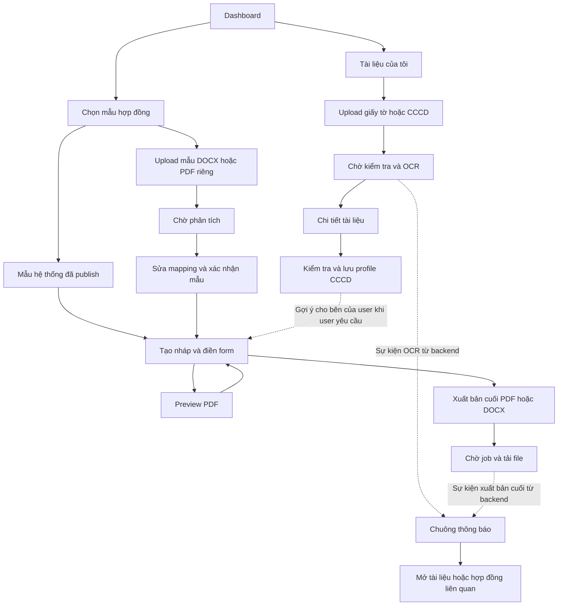

# Báo cáo bàn giao Frontend — Document, Contract, Notification

Ngày đối chiếu mã nguồn: **08/10/2026**. Phạm vi: ba service Document, Contract và Notification.

Tài liệu này dành cho FE dựng luồng màn hình, chia task và chuẩn bị mock theo hợp đồng API. Đây **không phải thông báo backend đã hoàn thiện**. Có thể gửi team FE ngay; khi API chạy thật, cập nhật trạng thái triển khai và nghiệm thu tích hợp.

## 1. Tình trạng hiện tại

| Thành phần | Hiện có | FE cần lưu ý |
| --- | --- | --- |
| Document | T1-6 file/CCCD/profile/processing; T7 outbox/adapter handoff; T8 Docker hardening/readiness/test. | Runtime thật hiện tắt theo user; migration005 đã apply, delivery mặc định tắt. Contract import/Notification receiver chưa implement. Chưa file thật/full cloud e2e; không KYC. Xem DOCUMENT_RELEASE.md. |
| Contract | Có health, `/me` kiểm tra JWT và `/templates` trả một mẫu demo hardcoded. | Catalog thật, mẫu cá nhân, nháp, checklist, gợi ý CCCD, preview và xuất file đều chưa triển khai. DB/worker vẫn ở mức thiết kế. |
| Notification | Có health và `/me` kiểm tra JWT. | Danh sách, badge, đánh dấu đã đọc, mute và tiếp nhận sự kiện đều chưa triển khai. DB vẫn ở mức thiết kế. |
| Frontend | Thư mục thực tế là `frontend/AI_Legal`. Có màn hình `user-dashboard.html`, `detail-information.html` và UI/JS mô phỏng. | Chưa thấy tích hợp ba service này trong các màn hình/JS đã đối chiếu. Luồng auth có code riêng; không kết luận toàn bộ FE chỉ có mock. |

Các thao tác OCR, QR, khuôn mặt/VNeID trên trang thông tin hiện có mô phỏng. Ba service này **không cung cấp xác minh VNeID, nhận diện khuôn mặt hay KYC**. UI chỉ được ghi “Thông tin CCCD đã được bạn kiểm tra”, không ghi “Đã xác thực danh tính/VNeID mức 2” dựa trên OCR hoặc lưu profile.

## 2. Quy ước gọi API

Luồng CCCD hai ảnh: xem [DOCUMENT_IDENTITY_OCR.md](DOCUMENT_IDENTITY_OCR.md). FE chọn front/back, giữ UUID Idempotency-Key khi retry, nhận sáu trường/warnings để user review. Không phụ thuộc VNPT; cần image có model/migration 003. 422 OCR_UNREADABLE chụp rõ hơn; 503 OCR_BUSY thử lại chủ động. Không tự lưu profile hoặc hiển thị đã xác minh danh tính.

### 2.1. Base URL và xác thực

- Qua Gateway local: `http://localhost:8080/api`. Các URL bên dưới đã bao gồm `/api`; không nối thêm `/api` lần nữa.
- Ví dụ: `http://localhost:8080/api/contracts/drafts`, **không phải** `http://localhost:8080/api/v1/contracts/drafts`.
- Nếu chạy riêng từng service: dùng `/api/v1/...` trên đúng host/port được cấu hình cho service đó. Không giả định cả ba cùng chạy một cổng trên máy host.
- Nghiệp vụ dùng access token do User Service cấp: `Authorization: Bearer <access_token>`. Document/Contract/Notification đều đã có lớp kiểm tra JWT chung; đây không phải token VNPT.
- Nếu dự án dùng cookie HttpOnly, thống nhất với luồng auth và cấu hình `credentials: "include"`. Không dùng refresh token hoặc Firebase ID token thô thay access token của backend.
- Owner lấy từ JWT; FE không truyền `owner_user_id` để quyết định quyền truy cập.
- FE gọi backend, không cần và không được nhận database password, Supabase service-role/secret key hoặc internal event token. Không push `.env` chứa secret lên GitLab.

### 2.2. Response và trạng thái HTTP

API JSON nghiệp vụ theo cấu trúc:

```json
{
  "data": {},
  "error": null,
  "request_id": "req-example"
}
```

- Danh sách: đọc `data.items` và `data.pagination` (`page`, `page_size`, `total`, `total_pages`). Demo `/templates` hiện không có pagination; không dùng demo làm chuẩn catalog thật.
- Lỗi: đọc `error.code`, `error.message`, nếu có thì hiển thị lỗi từng field từ `error.details`. Giữ `request_id` cho hỗ trợ/debug, không ghi dữ liệu CCCD vào log.
- `202`: mới nhận job, phải chờ xử lý; chưa được báo “đã OCR/xuất file thành công”.
- `204`: không có body; không gọi `response.json()` sau xóa file/nháp nếu endpoint trả 204.
- Health trả JSON đơn giản; endpoint lấy nội dung file trả binary, không áp dụng envelope JSON.
- `401`: dừng polling, đi qua luồng refresh/đăng nhập chung. `403`: thông báo không có quyền. `404`: phân biệt tài nguyên không tồn tại với route backend chưa được triển khai.
- `409`: hiển thị xung đột/trạng thái đang xử lý, không ghi đè hoặc retry vô hạn. `413/415/422`: hướng dẫn sửa file/dữ liệu phù hợp.

### 2.3. Cấu hình cần chốt trước khi tích hợp thật

1. Task 1 đã bổ sung `Idempotency-Key` vào CORS Gateway và test regression. Origin hiện cho phép chỉ là `localhost:3000` và `127.0.0.1:3000`; cổng/domain FE khác cần cấu hình thêm. Chưa nghiệm thu HTTP/container thật.
2. OpenAPI Notification định nghĩa danh sách là `GET /notifications` **không có slash cuối**, nhưng Gateway chỉ có location `/api/notifications/`. Cần bổ sung/chốt mapping exact `/api/notifications` đến `/api/v1/notifications`; hiện không coi URL danh sách là đã hoạt động. Không âm thầm đổi mock sang route khác hợp đồng.

Xem [tiến độ triển khai](DOCUMENT_IMPLEMENTATION_TASKS.md) để phân biệt cấu hình đã sửa trong repo với các điểm chưa kiểm tra runtime.

## 3. Danh sách màn hình cần dựng

Tên đường dẫn màn hình dưới đây là **đề xuất FE**, không phải API hay route đã có sẵn. Team có thể đổi tên route nhưng cần giữ các bước nghiệp vụ.

| Mã | Màn hình / thành phần | Vị trí đề xuất | Nội dung chính |
| --- | --- | --- | --- |
| D01 | Tài liệu của tôi | `/documents` | Danh sách file, bộ lọc, trạng thái, mở chi tiết, upload, tải/xóa. |
| D02 | Upload tài liệu | Modal từ D01 hoặc Contract | Chọn mục đích, loại giấy tờ, file và kiểm tra giới hạn. |
| D03 | Chi tiết/xử lý tài liệu | `/documents/:documentId` | Tiến trình kiểm tra/OCR, nội dung trích xuất, cảnh báo, xem/tải file. |
| D04 | Thông tin CCCD của tôi | Tận dụng `detail-information.html` | Chọn nguồn CCCD, kiểm tra/sửa sáu field, xác nhận lưu/thay/xóa profile. |
| C01 | Chọn mẫu hợp đồng | `/contracts/templates` | Hai tab: mẫu hệ thống và mẫu riêng; chọn version hợp lệ. |
| C02 | Nhập mẫu riêng | `/contracts/templates/import` | Upload DOCX/PDF, đặt tên, chờ phân tích. |
| C03 | Kiểm tra vị trí điền | `/contracts/templates/:templateId/review` | Xem tài liệu nguồn, sửa field/placements, lưu mapping, xác nhận. |
| C04 | Hợp đồng của tôi | `/contracts` | Danh sách nháp, mở/chỉnh sửa, lịch sử xuất và xóa khi được phép. |
| C05 | Soạn hợp đồng | `/contracts/:draftId/edit` | Form động, CCCD gợi ý, giấy tờ đính kèm, checklist và lưu nháp. |
| C06 | Preview/xuất hợp đồng | Trong C05 hoặc trang chi tiết | Preview PDF, chọn PDF/DOCX bản cuối, job, cảnh báo và tải file. |
| C07 | Quản trị mẫu hệ thống | Khu vực admin riêng | Tạo mẫu/version, publish, ẩn/hiện; không hiển thị cho citizen/lawyer. |
| N01 | Chuông thông báo | Layout/dashboard dùng chung | Badge chưa đọc, dropdown và popup thông báo mới. |
| N02 | Trung tâm thông báo | `/notifications` | Danh sách/phân trang, lọc đã đọc, đánh dấu và điều hướng tài nguyên. |
| N03 | Tùy chọn thông báo phòng tư vấn | Cài đặt phòng tư vấn | Bật/tắt popup phòng mà user là thành viên; không tự sửa suppression. |

Ưu tiên dựng D01–D04, C01/C04–C06 và N01–N02 trước. C02–C03 là luồng mẫu riêng đầy đủ; C07 là nhánh admin. N03 phối hợp với team Consultation, không cần tự xây nghiệp vụ phòng tư vấn trong ba service này.

## 4. Luồng màn hình liên service



Notification chỉ giúp user biết kết quả và quay lại màn hình; không thay thế polling job, không quyết định job thành công. Preview/phân tích mẫu không được giả lập thành sự kiện “đã xuất hợp đồng bản cuối”.

## 5. Document Service

**Trạng thái:** T3 file API, T4 hai ảnh OCR, T5 profile và T6 processing/extraction đã triển khai. File mới ban đầu queued; worker chỉ chạy khi nhóm bật overlay riêng, không giả lập trạng thái ở FE. Xem DOCUMENT_WORKER.md.

### 5.1. D01–D03: thư viện, upload, xử lý và chi tiết

| Thao tác UI | API theo hợp đồng | Dữ liệu / cách render |
| --- | --- | --- |
| Mở thư viện | `GET /api/documents/` | Params `page`, `page_size`, tùy chọn `purpose`, `document_type`; render tên file, loại, ngày, `file_status`, `processing_status`. |
| Upload | `POST /api/documents/` | Multipart `file`, `purpose`, `document_type`; header `Idempotency-Key` UUID. Lấy `data.document_id` để mở D03. |
| Mở chi tiết | `GET /api/documents/{document_id}` | Metadata và quyền thao tác theo trạng thái. |
| Theo dõi job | `GET /api/documents/{document_id}/processing` | `data.status`: `queued`, `processing`, `completed`, `failed`; đọc riêng `file_status`, `error_code`. |
| Xem trích xuất | `GET /api/documents/{document_id}/extraction` | `text`, `pages`, `extracted_fields`, `warnings`, `source_kind`; không tự bịa OCR/confidence. |
| Lấy link tải | `GET /api/documents/{document_id}/download` | `data.download_url`, `expires_at`; link riêng tư có hạn, hết hạn thì xin link mới. |
| Đọc file gốc | `GET /api/documents/{document_id}/content` | Binary; dùng khi cần viewer, không parse JSON. |
| Xóa | `DELETE /api/documents/{document_id}` | Xác nhận trước; thành công 204 thì bỏ khỏi danh sách. |

Quy tắc upload:

- Mẫu hợp đồng: `purpose=contract_template`, `document_type=contract`, chỉ DOCX/PDF.
- CCCD: `purpose=supporting_document`, `document_type=identity_card`, chỉ JPEG/PNG/PDF.
- Giấy tờ hỗ trợ khác: `purpose=supporting_document`, loại theo enum OpenAPI; `other` khi không thuộc loại chuyên biệt. Nhánh này hỗ trợ DOCX/PDF/JPEG/PNG.
- Tối đa **9 MiB (9.437.184 bytes)** mỗi file; PDF tối đa 100 trang. FE kiểm tra nhanh, server vẫn là bên quyết định file có hợp lệ/an toàn hay không.
- Không quảng bá hỗ trợ `.doc`, `.docm`, file mã hóa/khóa hoặc PDF có chữ ký. Không tự chuyển hai ảnh CCCD thành nguồn profile kết hợp khi hợp đồng chưa hỗ trợ.
- Tạo một Idempotency-Key cho mỗi thao tác; retry cùng request/file dùng lại key, thao tác mới dùng key mới. Không tái dùng key với body khác.
- T6 extracted_fields=[]: FE review text/layout, không tự gán phone/email/giá tiền. DOCX pages=[]; PDF trang text cùng raster có warning vùng ảnh chưa OCR. available+failed vẫn tải được; rejected không xem/tải.
- Poll job khoảng 2–3 giây là đề xuất UX. Dừng khi terminal, logout/lỗi auth hoặc rời màn hình; pause tab ẩn, khi quay lại đọc trạng thái mới trước khi tiếp tục. Chưa có API retry OCR riêng để FE tự gọi.

Hiển thị **hai trạng thái độc lập**: file `pending_check/available/rejected` và job `queued/processing/completed/failed`. OCR thất bại không nhất thiết file bị rejected; không cho import mẫu chỉ vì upload trả 202. File rejected không được xem/tải như file hợp lệ.

Xóa bị chặn khi job còn chạy hoặc file đang là nguồn profile CCCD (`PROFILE_SOURCE_IN_USE`, 409). Cần thay/xóa liên kết profile trước, không tự xóa profile thay user.

### 5.2. D04: CCCD nhập một lần, dùng gợi ý nhiều lần

1. Đọc `GET /api/documents/identity-profile/me` khi mở trang.
2. Chưa có profile: POST identity-ocr front/back với Idempotency-Key UUID; có profile: hiện dữ liệu đã xác nhận và nút “Thay nguồn”/“Ngừng dùng”.
3. Lấy session_id/fields của session completed vào form review, không dùng extraction của file mới queued. Field thiếu null; OCR không xác minh danh tính.
4. User bấm xác nhận mới `PUT /api/documents/identity-profile/me`.
5. Lưu revision trả về; dùng revision hiện tại cho lần thay/xóa kế tiếp. Xung đột 409 thì tải lại và cho user kiểm tra thay đổi.

Body PUT minh họa; UUID và thông tin bên dưới là dữ liệu giả cho mock:

```json
{
  "source_session_id": "11111111-1111-4111-8111-111111111111",
  "expected_revision": 0,
  "fields": {
    "full_name": "NGUYEN VAN A",
    "date_of_birth": "1995-01-20",
    "identity_number": "001095000001",
    "issue_date": null,
    "issue_place": null,
    "permanent_address": null
  }
}
```

- Gửi đủ **sáu key** trên; giá trị thiếu là `null`, ít nhất một field có dữ liệu. Ngày là `YYYY-MM-DD`; CCCD là chuỗi 12 số để giữ số 0 đầu.
- `expected_revision=0` chỉ cho lần đầu chưa từng có profile. Sau soft-delete không reset về 0; dùng `current_revision` theo response lỗi đọc profile đã xóa.
- Gỡ profile: `DELETE /api/documents/identity-profile/me?expected_revision=N`; soft-delete trả204 không body. GET404 kèm error.current_revision mới; không purge ảnh/JSON/file hoặc dữ liệu Contract, retention chưa có.
- PUT chọn một nguồn không-null: source_session_id T4 hoặc source_document_id available + latest completed (file mới cần bật worker T6). JSON<=16KiB; sáu key/date/ID/bounds theo IDENTITY_PROFILE_FILLING.md.
- Chỉ `IDENTITY_PROFILE_NOT_FOUND` mới hiển thị luồng chưa có profile; 404 do route chưa có phải hiển thị backend chưa sẵn sàng.
- Không thêm điện thoại/email, thông tin bên còn lại, giá tiền hay thời hạn vào profile CCCD.

## 6. Contract Service

**Trạng thái:** API nghiệp vụ dưới đây là planned. `/api/contracts/templates` hiện là demo, ID `CONTRACT-001` không phải UUID/version thật và không được dùng để tạo nháp qua API thiết kế.

### 6.1. C01: chọn mẫu

| Thao tác | API | Yêu cầu FE |
| --- | --- | --- |
| Danh sách mẫu hệ thống | `GET /api/contracts/template-catalog` | Phân trang; user chỉ chọn mẫu hiện và version đã published. |
| Chi tiết / phiên bản | `GET /api/contracts/template-catalog/{template_id}` và `GET /api/contracts/template-catalog/{template_id}/versions` | Lấy version hợp lệ; không nhầm template ID với `template_version_id`. |
| Schema version | `GET /api/contracts/template-versions/{version_id}` | Dựng form theo fields/schema của version đã chọn. |
| Mẫu riêng của tôi | `GET /api/contracts/user-templates` và `GET /api/contracts/user-templates/{template_id}` | Chỉ của owner; mẫu chưa confirmed dẫn sang C03, chưa được tạo nháp. |
| Xóa mẫu riêng | `DELETE /api/contracts/user-templates/{template_id}` | Xác nhận và xử lý lỗi theo trạng thái; không đưa mẫu riêng sang catalog công khai. |

### 6.2. C02–C03: upload mẫu riêng và kiểm tra vị trí điền

1. Upload DOCX/PDF qua Document với mục đích mẫu hợp đồng; chờ file/extraction đủ điều kiện theo hợp đồng.
2. `POST /api/contracts/user-templates`, body `{ "document_id": "UUID", "name": "Tên mẫu" }`, header `Idempotency-Key`; nhận job phân tích 202.
3. Poll `GET /api/contracts/template-analyses/{analysis_id}`: `queued → processing → needs_review`, hoặc `failed`; `confirmed` là trạng thái sau xác nhận.
4. Khi `needs_review`, lấy `GET /api/contracts/user-templates/{template_id}` và `GET /api/contracts/user-templates/{template_id}/source-preview`; dựng viewer và bảng field.
5. Sửa `name`, `label`, `type` (`text/date/number`), `required`, `placements`; chỉ đánh dấu `identity_key` khi đúng thông tin CCCD thuộc bên của user. Hiện confidence/cảnh báo, không biến confidence thành kết quả xác minh.
6. `PUT /api/contracts/user-templates/{template_id}/mapping`, body `{ "expected_revision": N, "fields": [...] }`. Gửi mapping đầy đủ; revision lấy từ `mapping_revision`. 409 thì tải lại, kiểm tra/merge trước khi lưu.
7. `POST /api/contracts/user-templates/{template_id}/confirm`, body `{ "expected_revision": N }` với revision mới nhất. Chỉ sau thành công/published mới dùng `template_version_id` tạo nháp.

Mỗi mẫu tối đa 100 field, mỗi field tối đa 20 placements. DOCX dùng locator cấu trúc; PDF dùng vị trí theo schema. Không áp dụng bbox OCR như locator DOCX. Với PDF, tọa độ chuẩn hóa theo trang đã xử lý crop/rotation; tránh xoay hai lần. Xem schema placement chi tiết trong OpenAPI, không tự tạo format tọa độ riêng.

DOCX giữ cấu trúc nhưng nội dung dài có thể đổi ngắt dòng/trang. PDF xuất DOCX là tái dựng, có thể có `LAYOUT_RECONSTRUCTED`; không cam kết giống tuyệt đối bản nguồn. Mẫu cá nhân không công khai, kể cả cho admin không liên quan.

### 6.3. C04–C05: tạo nháp và điền hợp đồng

| Thao tác UI | API | Yêu cầu |
| --- | --- | --- |
| Danh sách nháp | `GET /api/contracts/drafts` | Phân trang; có trạng thái rỗng/loading/lỗi. |
| Tạo nháp | `POST /api/contracts/drafts` | Body có `template_version_id`, `title`; tùy chọn `field_values`, `document_ids`, `procedure_id`. |
| Mở / lưu nháp | `GET /api/contracts/drafts/{draft_id}`, `PATCH /api/contracts/drafts/{draft_id}` | Dựng form theo version; chưa đủ required vẫn được lưu nháp. |
| Xóa nháp | `DELETE /api/contracts/drafts/{draft_id}` | Confirm; đang xuất file có thể bị chặn 409. |
| Checklist | `GET /api/contracts/drafts/{draft_id}/checklist` | Hiện `missing/attached/needs_review`; đính kèm không đồng nghĩa hồ sơ được cơ quan chấp nhận. |
| Cập nhật checklist | `POST /api/contracts/drafts/{draft_id}/checklist/refresh` | Gọi khi cần làm mới; không tự viết rule pháp lý ở FE. |
| Gợi ý CCCD | `POST /api/contracts/drafts/{draft_id}/identity-suggestions` | User chọn bên và bindings, kiểm tra gợi ý rồi mới lưu vào nháp. |

Ví dụ tạo nháp (UUID giả; tên field phải lấy từ schema của version thật):

```json
{
  "template_version_id": "22222222-2222-4222-8222-222222222222",
  "title": "Hợp đồng thuê nhà - bản nháp",
  "field_values": {},
  "document_ids": []
}
```

**Lưu nháp:** `PATCH field_values` thay **toàn bộ object**, `document_ids` thay **toàn bộ array** được gửi, không phải merge từng field trên server. FE phải merge dữ liệu hiện có trước khi gửi; key không gửi thì giữ nguyên. Không tự giả định API nháp có `expected_revision` giống API mapping/profile.

**Gợi ý CCCD:** nút “Dùng thông tin CCCD của tôi” mở chọn bên của user; không tự đoán bên A/B. Body ví dụ khi version có field `landlord_name` và user xác nhận mình là bên cho thuê:

```json
{
  "bindings": [
    { "field_name": "landlord_name", "identity_key": "full_name" }
  ]
}
```

Render `data.suggestions`, `manual_fields`, `warnings`; mỗi suggestion cần user duyệt. Sau khi chọn “Áp dụng”, merge giá trị vào form và PATCH nháp. API suggestions **không tự lưu**. Chưa có profile vẫn cho nhập tay; giá tiền, thời hạn và dữ liệu bên khác luôn nhập tay. Sửa profile CCCD sau này không được tự thay nội dung nháp/hợp đồng đã có.

### 6.4. C06: preview, xuất bản cuối và lịch sử

| Thao tác | API | UI cần làm |
| --- | --- | --- |
| Xem trước | `POST /api/contracts/drafts/{draft_id}/preview` | Header `Idempotency-Key`, không yêu cầu JSON body; tạo job preview PDF. |
| Xuất bản cuối | `POST /api/contracts/drafts/{draft_id}/generations` | Header `Idempotency-Key`; body `{ "format": "pdf" }` hoặc `{ "format": "docx" }`. |
| Theo dõi job | `GET /api/contracts/generations/{generation_id}` | `queued/processing/completed/failed`; xem `kind`, `warnings`, `error_code`. |
| Lịch sử | `GET /api/contracts/drafts/{draft_id}/generations` | Phân trang; phân biệt preview và final, job cũ thiếu kind hiểu là final theo hợp đồng. |
| Tải kết quả | `GET /api/contracts/generations/{generation_id}/download` | Dùng dữ liệu link tải theo schema, chỉ khi job completed. |

Preview cho kiểm tra cả khi chưa đủ field; bản cuối thiếu required bị 422 và cần highlight đúng field. Checklist thiếu giấy tờ không tự đồng nghĩa cấm xuất nháp hợp đồng. Khi generation queued/processing, backend có thể khóa sửa/xóa nháp (409); FE tránh double-click và hiển thị đang xử lý.

Poll khoảng 2–3 giây theo đề xuất UX, dừng terminal/rời màn hình/auth lỗi. Retry cùng thao tác dùng lại Idempotency-Key. Job final completed/failed có sự kiện Notification; preview không phát thông báo final. Backend Notification chưa nhận sự kiện không được làm FE đổi job completed thành failed.

### 6.5. C07: nhánh quản trị mẫu hệ thống

- Tạo/sửa/xóa metadata: `POST /api/contracts/template-catalog`, `PATCH /api/contracts/template-catalog/{template_id}`, `DELETE /api/contracts/template-catalog/{template_id}`.
- Tạo version: `POST /api/contracts/template-catalog/{template_id}/versions`.
- Sửa/xóa version: `PATCH /api/contracts/template-versions/{version_id}`, `DELETE /api/contracts/template-versions/{version_id}`.
- Publish: `POST /api/contracts/template-versions/{version_id}/publish`.
- Xem mẫu ẩn: query `include_hidden` chỉ dành cho admin. Mẫu mới bắt đầu ẩn; tạo version, publish rồi mới cho hiện.
- Version published không sửa trực tiếp; tạo version mới. Ẩn mẫu không được tự làm mất quyền đọc version đã được nháp owner tham chiếu theo hợp đồng.

FE ẩn menu admin nhưng backend vẫn phải kiểm tra role; ẩn UI không thay thế phân quyền. Render nội dung mẫu/OCR như dữ liệu, không chạy HTML/JavaScript từ file hoặc dùng `innerHTML` không an toàn.

## 7. Notification Service

**Trạng thái:** toàn bộ nghiệp vụ dưới đây planned; hiện có health và auth-context `/me`. Thiết kế là thông báo trong web qua polling, chưa có browser push, email, SSE hoặc WebSocket cho Notification.

### 7.1. N01–N02: chuông, danh sách, đã đọc và điều hướng

| Thao tác | API | Dữ liệu / cách xử lý |
| --- | --- | --- |
| Danh sách | `GET /api/notifications` | Params `page`, `page_size`, tùy chọn `is_read`, `include_suppressed`; cần sửa mapping Gateway nêu ở mục 2.3 trước tích hợp thật. |
| Badge | `GET /api/notifications/unread-count` | Đọc `data.unread_count`, không tính tổng từ một trang danh sách. |
| Đánh dấu một thông báo | `PATCH /api/notifications/{notification_id}/read` | Không yêu cầu body; cập nhật item và đọc lại badge. |
| Đã đọc tất cả | `POST /api/notifications/read-all` | Không yêu cầu body; đọc `data.updated_count`, làm mới list/badge. |
| Đọc cài đặt phòng | `GET /api/notifications/consultation-preferences/{consultation_id}` | Hiện `is_muted`, `is_suppressed`; chỉ khi có quyền thành viên. |
| Bật/tắt popup phòng | `PUT /api/notifications/consultation-preferences/{consultation_id}` | Body `{ "is_muted": true }` hoặc false; không gửi `is_suppressed`. |

Render item từ `id`, `title`, `message`, `event_type`, `resource_type`, `resource_id`, `is_read`, `is_muted`, `is_suppressed`, `created_at`, `read_at`.

Quy tắc UX polling đề xuất:

- Lần đầu tải danh sách/badge **không popup toàn bộ lịch sử**. Poll khoảng 10 giây khi tab hiện và user đăng nhập; tránh nhiều poller nếu layout/màn hình dùng chung.
- Dedupe theo `notification.id`; chỉ popup item mới chưa đọc, không muted và không suppressed. Poll phân trang không đảm bảo bắt từng sự kiện như realtime; list/badge backend vẫn là nguồn chính.
- Mute phòng chỉ tắt popup; thông báo vẫn nằm trong list và badge. Suppression do nghiệp vụ Consultation kiểm soát; mặc định không hiện list/badge. Không biến UI mute thành xóa thông báo.
- Khi click, đánh dấu đã đọc rồi mở màn hình theo cặp `resource_type/resource_id`; owner service kiểm tra quyền khi tải tài nguyên. Nếu đánh dấu thất bại, không giả báo đã đọc.

| Resource | Điều hướng FE đề xuất | Phối hợp |
| --- | --- | --- |
| `document` | D03 với `resource_id` là document ID | Hiện trạng thái/file/extraction mới nhất. |
| `contract` | C05/C06 với `resource_id` là draft ID theo event contract | Dùng lịch sử generations để tìm kết quả; không lấy draft ID làm generation ID. |
| `consultation` | Trang phòng/yêu cầu tư vấn của team Consultation | Không tự gọi API chưa được team đó chốt. |
| `lawyer`, `user` | Màn hình hồ sơ/trạng thái tương ứng | Chốt route với team sở hữu; chưa có route thì hiện chi tiết an toàn, không dựng link lỗi. |

### 7.2. Sự kiện và ranh giới backend

- Document: `document.ocr_completed`, `document.ocr_failed`.
- Contract bản cuối: `contract.generated`, `contract.generation_failed`.
- Event do backend producer gửi đến `POST /internal/v1/notifications/events`, có auth/idempotency nội bộ. **FE không gọi endpoint này**, không giữ internal token và không tự tạo thông báo “thành công” thay backend.
- Outbox/retry và chống trùng là trách nhiệm backend. FE vẫn được hiện toast cho kết quả thao tác hiện tại, nhưng toast đó không phải bản ghi Notification đã được lưu.

## 8. Mock và tiêu chí nghiệm thu cho team FE

Tách API client/mock adapter khỏi màn hình. Mock giữ đúng shape OpenAPI, UUID giả hợp lệ và sáu field CCCD; không dùng CCCD thật/secret. Mỗi service có cờ mock rõ ràng. API thật lỗi không được âm thầm trả mock thành công.

| Nhóm | Kịch bản cần có để dựng và test UI |
| --- | --- |
| Chung | Loading, danh sách rỗng, phân trang, lỗi mạng/5xx, token hết hạn, không có quyền, tài nguyên đã xóa; không lộ dữ liệu user trước sau logout. |
| Document | Upload hợp lệ; quá 9 MiB/sai loại; pending_check; available + OCR completed; available + OCR failed; rejected; link tải hết hạn; xóa khi job chạy/profile đang tham chiếu. |
| CCCD | Chưa có profile; OCR thiếu/sai field; số CCCD có 0 đầu; user sửa/xác nhận; thay nguồn; revision conflict; xóa rồi tạo lại không reset revision; không ghi nhãn KYC/VNeID. |
| Mẫu riêng | Import queued/processing/failed/needs_review; sửa nhiều placements; mapping conflict; xác nhận published; cảnh báo layout PDF→DOCX. |
| Nháp | Chọn đúng version; lưu thiếu required; thay toàn bộ field_values/document_ids không làm mất dữ liệu ngoài ý muốn; gợi ý CCCD cần duyệt; nhập tay khi không có profile. |
| Xuất file | Preview PDF; final PDF/DOCX; required thiếu 422; queued/processing khóa thao tác; double-click/retry không tạo nhiều job; completed tải được; failed có hướng dẫn phù hợp. |
| Notification | Lần tải đầu không spam popup; dedupe; badge theo unread-count; read/read-all; muted còn list/badge; suppressed không hiện mặc định; resource đã xóa/không đủ quyền có thông báo thân thiện. |

Hoàn thành FE mock khi đi được các luồng mục 4 và các trạng thái trên. Chỉ gọi là **tích hợp thật hoàn thành** sau khi:

1. Backend triển khai endpoint/DB/worker tương ứng và test owner/role.
2. Gateway chốt route danh sách Notification, header Idempotency-Key và origin FE.
3. Có dữ liệu test, UUID/version thật và access token từ User Service; không dùng demo `CONTRACT-001` để tạo draft.
4. Test upload → xử lý → CCCD duyệt → nháp → preview → final → thông báo → tải file; kèm nhánh lỗi/quyền/trùng request.

Không cần chờ backend xong mới dựng màn hình; cần chốt hợp đồng và giữ rõ nhãn mock/planned để team biết bước nào chưa thể gọi thật.

## 9. Tài liệu gốc và cách bàn giao

Nguồn đối chiếu: `app/main.py` của ba service, ba OpenAPI chính, cấu hình Gateway và màn hình FE hiện có. Trạng thái code trong mục 1 là snapshot ngày ghi trên đầu tài liệu, không phải kiểm tra môi trường cloud đang chạy ở thời điểm FE đọc.

- [Document OpenAPI](../../services/document-service/openapi.yaml)
- [Contract OpenAPI chính](../../services/contract-service/openapi.yaml) — nguồn chính cho cả mẫu hệ thống và mẫu riêng.
- [Notification OpenAPI](../../services/notification-service/openapi.yaml)
- [Luồng Document nối Contract](DOCUMENT_CONTRACT_INTEGRATION.md)
- [Hồ sơ CCCD và gợi ý điền](IDENTITY_PROFILE_FILLING.md)
- [Mẫu riêng, mapping và preview](USER_CONTRACT_TEMPLATES.md)
- [Sự kiện/polling Notification](NOTIFICATION_INTEGRATION.md)
- [Gateway hiện tại](../../gateway/nginx.conf)

Gửi file này cùng OpenAPI cho FE để chia task. Khi backend hoàn thiện từng nhóm endpoint, cập nhật trạng thái và thông báo payload/route thay đổi. Nếu tài liệu cũ nói Gateway đã hỗ trợ Idempotency-Key hoặc dùng prefix khác, đối chiếu mã nguồn/OpenAPI hiện tại và mục 2.3; không coi mô tả cũ là bằng chứng route đã chạy.
